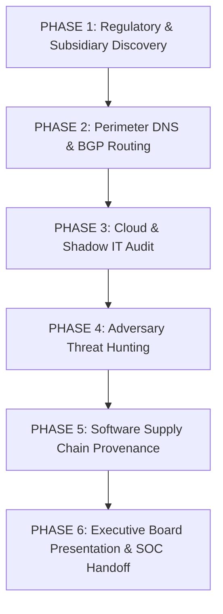

# 🎓 Section 12: Capstone Investigation
**Project Reference:** `OSINT-CAPSTONE-2026`  
**Classification:** `TLP:CLEAR // SIMULATED INCIDENT`  
**Scenario Title:** Operation Horizon Shield — Enterprise Attack Surface Audit & Board Briefing  
**Authoritative Framework:** NIST SP 800-115 / MITRE ATT&CK / Diamond Threat Model  

---

```
╔════════════════════════════════════════════════════════════════════════╗
║                   FINAL CAPSTONE INCIDENT BRIEFING                     ║
║                                                                        ║
║  TARGET ENTITY:      Aether Dynamics Global Corporation                ║
║  SIMULATED DOMAIN:   aetherdynamics-global[.]com                       ║
║  SCENARIO TYPE:      Pre-Breach Attack Surface Audit & Threat Hunt     ║
║  TIME ALLOCATION:    20 to 30 Hours (Simulated 2-Week Engagement)      ║
║  DELIVERABLES:       Full Evidence Vault + Executive Board Slide Deck  ║
║  PREREQUISITE:       Completion of Cases 01 through 30                 ║
╚════════════════════════════════════════════════════════════════════════╝
```

---

## 🏛️ Executive Scenario & Operational Context

You have been hired as a Lead Cyber Threat Intelligence (CTI) Consultant by the Board of Directors of **Aether Dynamics Global**, a multinational aerospace and logistics enterprise preparing for a high-profile initial public offering (IPO). 

Two weeks ago, the Chief Information Security Officer (CISO) received an unverified tip from a commercial threat intelligence partner indicating that a sophisticated cyber threat group is weaponizing external infrastructure to target Aether Dynamics' defense supply chain.

The Board of Directors has commissioned an **independent, 100% passive external attack surface audit**. They have strictly forbidden any active network scanning, credential probing, or intrusion attempts. Your mission is to map their complete external exposure, uncover rogue shadow IT and dangling cloud assets, detect adversary infrastructure clusters, and deliver an audit-ready executive intelligence briefing.

---

## 🎯 Primary Priority Intelligence Requirements (PIRs)

The Board has established five non-negotiable Priority Intelligence Requirements:

1. **PIR 1 (Corporate Holdings & Subsidiaries):** What wholly-owned subsidiary brands, international operating entities, and corporate officers exist within the enterprise umbrella?
2. **PIR 2 (Perimeter Infrastructure & Mail Defenses):** What are the authoritative DNS nameservers, BGP routing prefixes, mail exchangers, and email anti-spoofing enforcement levels (SPF/DMARC) across the primary domain and all subsidiaries?
3. **PIR 3 (Shadow IT & Orphaned Cloud Assets):** Are there unmapped subdomains, development staging portals, exposed OpenAPI/Swagger specifications, or dangling CNAME pointers to abandoned cloud storage buckets?
4. **PIR 4 (Adversary Infrastructure & Typosquatting):** Are there registered domain permutations, active look-alike phishing gateways with live MX records, or Command & Control (C2) clusters mimicking the corporate brand?
5. **PIR 5 (Software Supply Chain Provenance):** What open-source software libraries, CI/CD pipelines, and third-party SaaS OAuth integrations are exposed in the organization's public code repositories?

---

## 🧭 The 6-Phase Capstone Execution Roadmap



---

### Phase 1: Corporate Structure & Regulatory Discovery
* **Task 1.1:** Ingest regulatory filings (simulated SEC Form 10-K Exhibit 21 and Form 8-K merger disclosures).
* **Task 1.2:** Map the legal entity hierarchy: Identify at least two newly acquired subsidiaries operating under separate apex domain names.
* **Task 1.3:** Extract Board of Director rosters (Form DEF 14A) and map interlocking directorships with outside technology vendors using OpenCorporates and Wikidata.
* **Deliverable:** Subsidiary and directorship connection matrix with cryptographic SHA-256 evidence hashes.

---

### Phase 2: Autonomous Attack Surface & Mail Hygiene Mapping
* **Task 2.1:** Execute passive subdomain enumeration using Certificate Transparency logs (`crt.sh` API) across the primary domain and all subsidiary apex domains.
* **Task 2.2:** Query BGP routing tables (BGPView / RIPE Stat) to map the enterprise's allocated IPv4/IPv6 CIDR prefixes and upstream Tier-1 internet service providers.
* **Task 2.3:** Audit email authentication headers:
  * Check SPF records for overly permissive terminal qualifiers (`~all` or `+all`).
  * Check DMARC policies for lack of enforcement (`p=none` vs. `p=reject`).
* **Deliverable:** Authoritative infrastructure catalog and mail spoofing vulnerability assessment.

---

### Phase 3: Cloud Storage & Shadow IT Namespace Audit
* **Task 3.1:** Inspect discovered subdomains for dangling `CNAME` records pointing to unclaimed third-party cloud assets (AWS S3, Azure Blob, GitHub Pages, Heroku).
* **Task 3.2:** Execute passive HTTP `HEAD` queries to verify whether any discovered cloud bucket returns `NoSuchBucket` or exposes public XML directory listings.
* **Task 3.3:** Locate and download publicly published OpenAPI / Swagger specifications to map internal API endpoints, authentication schemes, and parameter formats.
* **Deliverable:** High-severity dangling asset risk ledger with exact DNS pruning instructions.

---

### Phase 4: Adversary Threat Hunting & Brand Impersonation Triage
* **Task 4.1:** Run `dnstwist` to generate an algorithmic typosquatting threat matrix targeting the corporate brand name.
* **Task 4.2:** Filter the matrix to identify registered look-alike domains with active `MX` mail exchanger records configured for phishing campaigns.
* **Task 4.3:** Query public threat intelligence telemetry (AlienVault OTX, ThreatFox) for JARM TLS fingerprints matching known adversary Command & Control (C2) frameworks.
* **Task 4.4:** Model the discovered adversary campaign using the Diamond Model of Intrusion Analysis and MITRE ATT&CK mapping.
* **Deliverable:** Prioritized phishing triage dossier and Diamond threat model diagram.

---

### Phase 5: Software Supply Chain & Code Provenance
* **Task 5.1:** Audit the organization's public software repositories (GitHub organization):
  * Extract developer commit email patterns and corporate email syntax.
  * Audit CI/CD workflow files for hardcoded webhook URLs or unpinned third-party GitHub Actions.
* **Task 5.2:** Generate a Software Bill of Materials (SBOM) for the organization's primary public application and evaluate dependencies using OpenSSF Scorecard metrics.
* **Deliverable:** Supply chain risk audit detailing third-party dependency exposure.

---

### Phase 6: Executive Board Presentation & SOC Defensive Handoff
* **Task 6.1:** Author the formal **Comprehensive Intelligence Assessment Report** using [`FINAL_INTELLIGENCE_REPORT_TEMPLATE.md`](../templates/FINAL_INTELLIGENCE_REPORT_TEMPLATE.md).
* **Task 6.2:** Develop an Executive Board Presentation Slide Deck (10–12 slides) designed for non-technical C-suite leadership:
  * Slide 1: Title & Executive Mandate
  * Slide 2: Bottom-Line Up Front (BLUF)
  * Slide 3: Discovered External Attack Surface Topology
  * Slide 4: Critical Exposure #1 — Dangling Cloud Assets & Domain Hijacking
  * Slide 5: Critical Exposure #2 — Email Spoofing & Phishing Gateway Risks
  * Slide 6: Critical Exposure #3 — Active Impersonation Infrastructure Clusters
  * Slide 7: Supply Chain & Software Dependency Resilience
  * Slide 8: Diamond Threat Model of Active Adversary
  * Slide 9: Immediate 72-Hour Defensive Remediation Plan
  * Slide 10: 90-Day Enterprise Architecture Hardening Roadmap
* **Task 6.3:** Author production-ready defensive controls for immediate SOC deployment:
  * 1 Production SIGMA rule for enterprise SIEM detection.
  * 1 Snort/Suricata network intrusion detection signature.
  * 1 Incident Response Playbook for Tier 1 SOC analysts.

---

## 🏆 Capstone Grading & Defense Evaluation Criteria

The Capstone Investigation is graded on a **100-Point Professional Standard** evaluated by senior cybersecurity reviewers:

| Evaluation Dimension | Points | Description |
| :--- | :---: | :--- |
| **PIR Completion & Evidence Rigor** | 30 pts | All 5 PIRs fully answered with cryptographic SHA-256 hashes, valid UTC timestamps, and unbroken chain of custody. |
| **Strict Ethical Compliance** | 25 pts | Zero active port scanning (`nmap`), zero brute-forcing, zero private citizen targeting, zero intrusive payloads. Automatic failure if violated. |
| **Analytical Attribution & Modeling** | 20 pts | Defensible Admiralty 6×6 confidence ratings, correct Diamond Model correlation, and accurate MITRE ATT&CK mapping. |
| **Executive Briefing & Presentation** | 15 pts | High-impact BLUF, clear visual diagrams, tailored communication appropriate for corporate board members. |
| **Actionable Defensive Engineering** | 10 pts | Validated SIGMA rules, perimeter IDS signatures, and practical engineering mitigation playbooks. |

---

## 🎓 Career Milestone: Capstone Defense
Upon achieving a score of $\ge 90\%$ on the Capstone Investigation, the student earns the **Principal OSINT Strategist** credential and incorporates the complete deliverable into their public professional portfolio.
