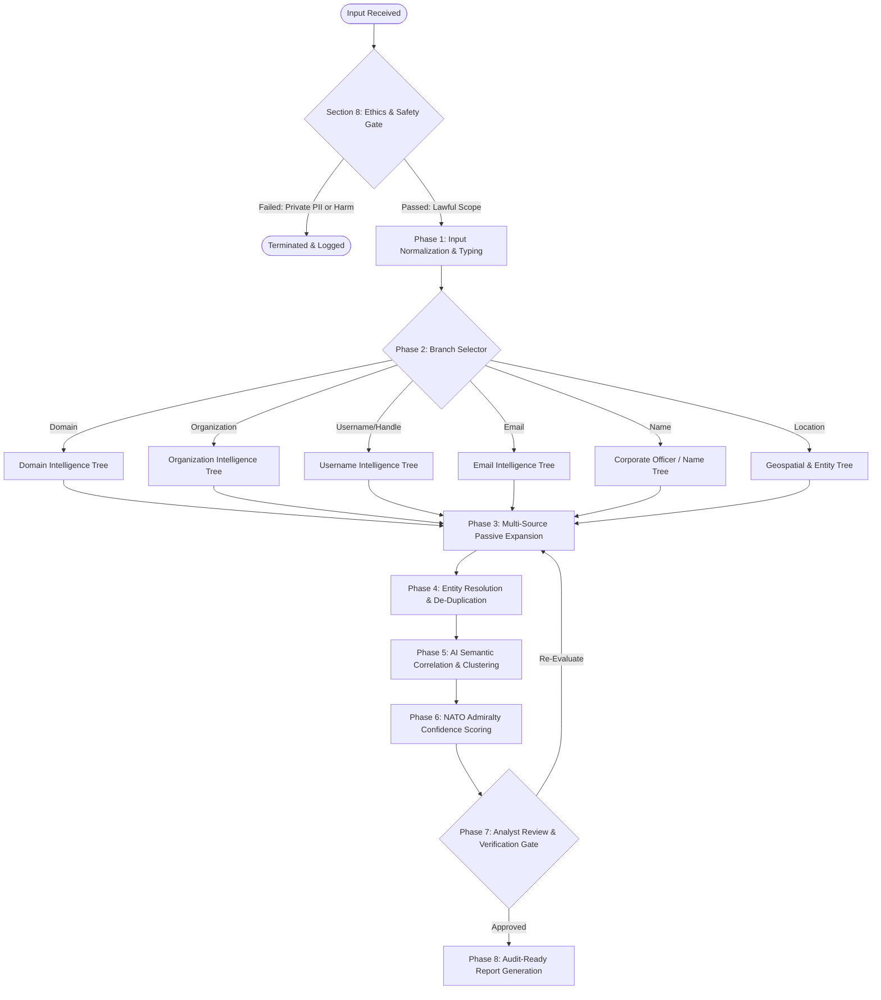
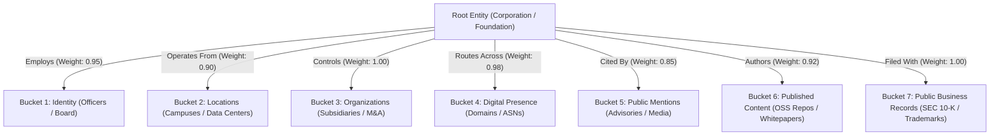

# 🛡️ Ethical AI-Powered OSINT Investigation Framework & Architecture
**Standard Reference:** `OSINT-AI-FRAMEWORK-01`  
**Standard Authority:** Candy Chevalier | CandySueC LLC & Evidra Technologies LLC  
**Multidisciplinary Advisory Council:**
1. Senior OSINT Investigator
2. Threat Intelligence Analyst
3. Digital Forensics Examiner
4. Cybersecurity Architect
5. Data Scientist
6. AI Systems Architect
7. Privacy Attorney
8. Compliance Officer

**Charter & Classification:** `PUBLIC / TLP:CLEAR` | Defensive, Lawful, Ethical Open-Source Intelligence  
**Mandatory Ethical Guardrails:** Zero Unauthorized Infiltration | Zero Private Citizen Stalking | Zero Credential Harvesting | Zero Surveillance  

---

```
╔═══════════════════════════════════════════════════════════════════════════════╗
║                   ETHICAL AI-POWERED OSINT ARCHITECTURE                       ║
║                                                                               ║
║   INPUT INGESTION   ──►   ETHICS & COMPLIANCE GATEWAY   ──►   PASSIVE RECON   ║
║   (17 Input Types)        (Zero PII Harvest / Legal)          (Public APIs)   ║
║                                                                      │        ║
║                                                                      ▼        ║
║   REPORT GENERATOR  ◄──   ANALYST REVIEW & AUDIT   ◄──   AI CORRELATION &     ║
║   (Citations & Gaps)      (Human-in-the-Loop)            ENTITY RESOLUTION    ║
╚═══════════════════════════════════════════════════════════════════════════════╝
```

---

# SECTION 1: INPUT TYPES & OSINT METHODOLOGIES

The ingestion subsystem sanitizes, types, and validates 17 standard public input modalities. Active network intrusion, credential sniffing, or private database querying are architecturally prohibited.

| # | Input Type | Ingestion Validation & Normalization | Suitable Ethical OSINT Methodologies | Disallowed Actions |
| :-: | :--- | :--- | :--- | :--- |
| **01** | **Full Name** | Strip illegal characters; normalize Unicode; extract tokens (First, Middle, Last, Suffix). | Query open corporate filings (SEC Form 10-K, DEF 14A, OpenCorporates), public academic publications (Google Scholar, ORCID), and news mentions. | Do NOT query private consumer credit bureaus, voter rolls, or unauthorized background check databases. |
| **02** | **Partial Name** | Regex normalization; phonetic encoding (Soundex, Metaphone). | Disambiguation via cross-referencing published organizational rosters, press releases, or conference speaker schedules. | Do NOT make probabilistic guesses without secondary technical anchors. |
| **03** | **Alias** | Case-insensitive tokenization; handle character mapping. | Query public open-source project commit logs, bug tracking platforms, and public developer forums. | Do NOT link aliases across platforms without cryptographic or verifiable corroboration. |
| **04** | **Username** | Strip leading `@`; alphanumeric + standard delimiter regex (`^[a-zA-Z0-9_\-\.]+$`). | Query platform profile availability APIs (Sherlock/Maigret logic); analyze public profile bios, avatar hashes, and creation timestamps. | Do NOT attempt password brute-forcing or login enumeration. |
| **05** | **Email Address** | RFC 5322 validation; split into local-part and domain-part. | Query domain DNS MX/SPF/DMARC; check authoritative business directories; check public Git commit logs. | Do NOT query unredacted dark-web combo dumps or send probing emails. |
| **06** | **Domain Name** | FQDN syntax check (RFC 1035); strip scheme (`http://`); IDN Punycode decoding. | Certificate Transparency logs (`crt.sh`), passive DNS history, BGP ASN mapping, RDAP/WHOIS registrar analysis. | Do NOT execute active port scans (`nmap`), directory fuzzing, or vulnerability probes. |
| **07** | **Company Name** | Legal suffix standardization (Inc, LLC, Ltd, Corp, GmbH, SA). | SEC EDGAR (CIK lookup), State Secretary of State public registry, USPTO trademark registries, OpenCorporates. | Do NOT request internal proprietary financial data. |
| **08** | **Physical Address**| USPS / ISO postal parsing; geocode to bounding coordinates. | Public municipal property tax records, county zoning parcels, OpenStreetMap (OSM) vector maps. | Do NOT conduct physical surveillance or intercept mail. |
| **09** | **City** | Geonames / UN/LOCODE mapping; state/country disambiguation. | Regional open government datasets, business license registries. | Broad geographic queries only; never isolate residential zones. |
| **10** | **State / Province**| ISO 3166-2 code resolution. | State business entity databases, judicial transparency portals (court opinions). | Public legal archives only. |
| **11** | **Country** | ISO 3166-1 alpha-2 / alpha-3 resolution. | National business registries (e.g., UK Companies House, French Infogreffe), ccTLD root DNS records. | Respect international jurisdictional data boundaries. |
| **12** | **Phone Number (Public)**| E.164 international format parsing via Google `libphonenumber`. | Telco carrier allocation block lookup (NANPA/ITU), official corporate "Contact Us" directories. | Do NOT ping HLR lookups or query private CNAM databases. |
| **13** | **Social Media Handle** | Platform slug extraction (`twitter.com/x`, `linkedin.com/in`). | Scrape public open graph meta tags, public profile text, and official verified badges. | Do NOT create fake sock-puppet accounts to request private friend connections. |
| **14** | **Business Name** | Trade name / DBA (Doing Business As) mapping. | State trade name registers, chamber of commerce public registries. | Verified public business filings only. |
| **15** | **Website URL** | URI parsing (RFC 3986); validate hostname and path. | Wayback Machine historical crawl indexing, Open Graph metadata extraction, `robots.txt` parsing. | Do NOT execute SQL injection or XSS scanners. |
| **16** | **Image** | MIME validation (PNG, JPEG, WebP); strip malicious polyglots. | Reverse image search against public indexes (TinEye, Google Images), ExifTool metadata inspection (camera make, lens, creation date). | Do NOT utilize facial recognition on non-public individuals or crowd photos. |
| **17** | **Organization** | Entity classification (Non-profit, Foundation, Consortium). | IRS Form 990 public disclosures (ProPublica Nonprofits), EU Transparency Register, GitHub public org APIs. | Strictly public tax and governance disclosures. |

---

# SECTION 2: INVESTIGATION DECISION TREES & ALGORITHMS

## 2.1 The Core Intelligence Lifecycle Engine



---

## 2.2 Branching Logic & Pseudocode

### Branch 1: Domain-Only Investigation
```python
def investigate_domain(domain: str) -> DomainIntelGraph:
    # Step 1: Input Validation & Sanitization
    clean_domain = sanitize_fqdn(domain)
    
    # Step 2: Passive DNS & Routing Footprint
    ns_records = dns_query(clean_domain, record_type="NS")
    mx_records = dns_query(clean_domain, record_type="MX")
    txt_records = dns_query(clean_domain, record_type="TXT")
    a_records = dns_query(clean_domain, record_type="A")
    asn_data = bgp_lookup(a_records)
    
    # Step 3: Certificate Transparency Mining (Zero Probing)
    subdomains = query_crt_sh(clean_domain)
    
    # Step 4: Email Spoofing Defense Evaluation
    spf_status = parse_spf(txt_records)
    dmarc_status = query_dmarc(clean_domain)
    
    # Step 5: Web Preservation Drift
    historical_snapshots = query_wayback_cdx(clean_domain)
    
    return aggregate_domain_graph(clean_domain, ns_records, mx_records, subdomains, asn_data, spf_status, dmarc_status)
```

### Branch 2: Organization / Corporate Entity Investigation
```python
def investigate_organization(org_name: str, jurisdiction: str = None) -> OrgIntelGraph:
    # Step 1: Legal Registry Verification
    sec_filings = query_sec_edgar(org_name)
    state_filings = query_opencorporates(org_name, jurisdiction)
    
    # Step 2: Subsidiary & Directorship Graphing
    subsidiaries = extract_exhibit_21(sec_filings)
    officers = extract_def_14a_directors(sec_filings)
    
    # Step 3: Public Digital Asset Discovery
    registered_domains = pivot_domains_by_registrant(state_filings.corporate_name)
    public_git_orgs = query_github_org_api(org_name)
    
    # Step 4: Correlation
    return construct_organization_graph(org_name, subsidiaries, officers, registered_domains, public_git_orgs)
```

### Branch 3: Public Technical Username / Handle Investigation
```python
def investigate_username(username: str) -> UsernameCluster:
    # Step 1: Query Public Developer & Code Repositories
    github_profile = query_public_api("github", username)
    gitlab_profile = query_public_api("gitlab", username)
    docker_profile = query_public_api("dockerhub", username)
    
    # Step 2: Triangulation via 3-Point Corroboration Rule
    verified_matches = []
    for profile in [github_profile, gitlab_profile, docker_profile]:
        if profile.exists:
            # Must verify public GPG key, corporate domain email, or canonical blog URL
            if has_corroborating_anchor(profile):
                verified_matches.append(profile)
            else:
                mark_as_potential_collision(profile)
                
    return build_username_cluster(username, verified_matches)
```

---

# SECTION 3: SOURCE CATALOG & ACQUISITION MATRIX

Every cataloged source is assigned a collection methodology, baseline reliability score, and validation protocol.

```
┌────────────────────────────────────────────────────────────────────────┐
│                        SOURCE CATALOG TAXONOMY                         │
├────────────────────────────────────────────────────────────────────────┤
│  1. PUBLIC SEARCH      Search Engines, CDX Web Archives, Sitemaps      │
│  2. BUSINESS INFO      SEC EDGAR, OpenCorporates, USPTO Registries     │
│  3. DOMAIN INTEL       DNS Resolvers, crt.sh, BGPView, ICANN RDAP      │
│  4. IMAGE INTEL        ExifTool Metadata, TinEye, Creative Commons     │
│  5. SOCIAL PRESENCE    Public Verified Accounts, GitHub Commit Logs    │
│  6. NEWS & MEDIA       Factiva, Google News, Declassified Bulletins    │
│  7. OPEN DATA          Data.gov, World Bank, OpenStreetMap, EU Data   │
└────────────────────────────────────────────────────────────────────────┘
```

| Source Category | Collection Method | Baseline Reliability | Validation Protocol | Permitted Usage |
| :--- | :--- | :---: | :--- | :--- |
| **Public Search** | Structured HTTP GET with standard User-Agent via public APIs or CDX indexing. | **B** (Usually Reliable) | Cross-reference search results against live original web host archives. | Passive directory discovery, cache extraction. |
| **Business Info** | REST API ingestion of government records (SEC EDGAR, UK Companies House). | **A** (Completely Reliable) | Cryptographic signature verification of government documents. | Corporate hierarchy, officer disclosures, M&A due diligence. |
| **Domain Intel** | Direct RFC-compliant DNS queries (`dig`), CT log APIs (`crt.sh`), RIPE NCC BGP collectors. | **A** (Completely Reliable) | Signed DNSSEC responses, immutable append-only CT log proofs. | External attack surface mapping, SPF/DMARC audits. |
| **Image Intel** | Local execution of `exiftool` on downloaded media; hash matching on public indexes. | **B** (Usually Reliable) | Verification of internal EXIF byte offsets and timestamp consistency. | Camera/lens profiling, verification of public event locations. |
| **Social Presence** | Read-only public platform API queries (Open Graph, public author profiles). | **C** (Fairly Reliable) | Mandatory 3-point cross-corroboration (PGP signature, stated organization, domain anchor). | Professional affiliation mapping, bot identification. |
| **News & Media** | RSS feed parsing, press release archives. | **B** (Usually Reliable) | Trace citations to primary technical reports or corporate disclosures. | Corporate restructuring timelines, executive appointment announcements. |
| **Open Data** | GeoJSON downloads (OpenStreetMap Overpass API), open municipal GIS endpoints. | **A** (Completely Reliable) | Vector topology checks and municipal property assessor records. | Facility perimeter auditing, natural disaster hazard modeling. |

---

# SECTION 4: SOURCE CONFIDENCE MODEL (NATO STANAG 2022)

The engine enforces an objective, mathematical confidence rating based on the **NATO STANAG 2022 / Admiralty 6×6 System**:

```
                       SOURCE RELIABILITY
       A: Completely Reliable  (Government filings, Signed DNS, CT Logs)
       B: Usually Reliable     (Established CTI aggregators, Major news)
       C: Fairly Reliable      (Independent researchers, Public blogs)
       D: Not Usually Reliable (Unverified paste sites, Anonymous boards)
       E: Unreliable           (Known disinformation, Doppelgänger mirrors)
       F: Cannot Be Judged     (Unprecedented / Untracked source)

                     INFORMATION CREDIBILITY
       1: Confirmed by other independent sources
       2: Probably True (Logical, indirect technical support)
       3: Possibly True (Plausible, lacks technical corroboration)
       4: Doubtful (Contradicts established networking/records)
       5: Improbable (Demonstrably false or technically impossible)
       6: Truth Cannot Be Judged
```

### Formulaic Confidence Index (CI) Calculation

$$CI = \left( W_{\text{source}} \times S \right) + \left( W_{\text{credibility}} \times C \right) + \left( W_{\text{corroboration}} \times K \right) - P_{\text{staleness}}$$

Where:
* $S \in [1.0, 0.0]$: Normalized source reliability ($A=1.0, B=0.8, C=0.6, D=0.4, E=0.2, F=0.0$).
* $C \in [1.0, 0.0]$: Normalized information credibility ($1=1.0, 2=0.8, 3=0.6, 4=0.4, 5=0.2, 6=0.0$).
* $K \in [0, 1.0]$: Corroboration factor ($0.0$ for single-source; $+0.3$ per independent technical conduit, capped at $1.0$).
* $P_{\text{staleness}}$: Decay penalty for records older than 24 months without renewal.

### Composite Score Thresholds:
* **High Confidence (Green):** $CI \ge 0.85$ (Admiralty **A1**, **A2**, **B1**) $\rightarrow$ Production-ready for executive decision-making.
* **Medium Confidence (Yellow):** $0.60 \le CI < 0.85$ (Admiralty **B2**, **B3**, **C2**) $\rightarrow$ Requires secondary corroboration.
* **Low Confidence (Red):** $CI < 0.60$ (Admiralty **C3**, **D4**, or lower) $\rightarrow$ Retained as investigative leads only; excluded from final executive findings.

---

# SECTION 5: ENTITY RESOLUTION & HOMOGLYPH DISAMBIGUATION

A primary failure in automated OSINT is collapsing two disparate entities with identical names into a single profile. The framework enforces an **Evidence-Based Disambiguation Pipeline**:

```
      ENTITY CANDIDATE: "John Smith" (Profile A)       ENTITY CANDIDATE: "John Smith" (Profile B)
      • Role: VP Infrastructure, Fastly                 • Role: Branch Manager, Regional Bank
      • Anchor: fastly.com email / GPG key             • Anchor: Personal finance blog / LinkedIn
      ────────────────────────────────────────         ────────────────────────────────────────
                                    ▼                              ▼
                          [VECTOR DISTANCE COMPARISON]
                          • Jaccard Distance on Corporate Affiliations: 0.05 (No overlap)
                          • Domain Signature Match: False
                          • Geographic Anchor: San Francisco, CA vs. Columbus, OH
                                    ▼
                    [DECISION: DISTINCT ENTITY IDENTIFIERS]
                    Entity_A: `ENT-UUID-9182-FASTLY`
                    Entity_B: `ENT-UUID-3814-BANK`
```

### The 4 Disambiguation Pillars:
1. **Pillar 1: Corporate / Organization Anchor:** Matching SEC CIK registrations, corporate email domains, or organizational employer records.
2. **Pillar 2: Geographic & Jurisdictional Anchor:** Disambiguating by operational state/country of registration.
3. **Pillar 3: Temporal Alignment:** Validating that tenure, employment dates, and publication timelines do not mathematically conflict.
4. **Pillar 4: Cryptographic Anchor:** Matching PGP key fingerprints, SSH author signatures, or authorized DNS TXT records.

---

# SECTION 6: AI CORRELATION & RELATIONSHIP CLUSTERING

The correlation engine maps unstructured passive findings into 7 structured property buckets, generating weighted relationship edges:



### Edge Weighting Matrix:
* **Deterministic Edge ($1.00$):** First-party legal filings (SEC Form 10-K Exhibit 21 listing wholly-owned subsidiaries).
* **Cryptographic Edge ($0.98$):** Certificate Transparency log where Subject Alternative Name explicitly binds domain to parent organization.
* **Technical Edge ($0.90$):** BGP routing table indicating IP prefix is announced by the enterprise ASN.
* **Probabilistic Edge ($0.65$):** Textual co-occurrence in a third-party news publication.

---

# SECTION 7: AUDIT-READY REPORT GENERATION ENGINE

Every report produced by the framework adheres strictly to the following 7-section structure:

1. **Executive Summary (BLUF):** Bottom-Line Up Front written for executive leadership; highlights the primary external vulnerability, digital footprint scope, and immediate action items.
2. **Chronological Intelligence Timeline:** Timestamped sequence of key events (domain registrations, certificate issuances, corporate restructurings, disclosures).
3. **Evidence Matrix (With SHA-256 Hashes):** Exhaustive table recording Item #, UTC Timestamp, Canonical URL, SHA-256 Checksum, Artifact Path, and Admiralty Score.
4. **Source Inventory & Authority Table:** Complete accounting of all queried databases, APIs, and public search engines.
5. **Confidence Assessment:** Transparent evaluation detailing why specific findings are rated High vs. Medium confidence.
6. **Information Gaps & Blind Spots:** Explicit documentation of what could *not* be verified passivly (e.g., origin IP obscured by Anycast CDN).
7. **Recommended Next Steps & SOC Engineering Handoff:** Actionable mitigation playbooks, DNS cleanup instructions, and production SIGMA/YARA rules.

---

# SECTION 8: THE ETHICS & COMPLIANCE ENGINE

The Ethics Engine operates as an un-bypassable software gate. Before any finding is displayed to the analyst or exported to a report, it must pass five automated compliance filters:

```
┌────────────────────────────────────────────────────────────────────────┐
│                        THE 5-FILTER ETHICS GATE                        │
├────────────────────────────────────────────────────────────────────────┤
│  [ FILTER 1: PUBLIC ACCESSIBILITY ] ──► Is data unauthenticated?       │
│  [ FILTER 2: LAWFUL CONDUIT       ] ──► Complies with CFAA & GDPR?     │
│  [ FILTER 3: TEMPORAL HYGIENE     ] ──► Is record current / unexpired? │
│  [ FILTER 4: MULTI-SOURCE PROOF   ] ──► Corroborated by ≥ 2 sources?   │
│  [ FILTER 5: HARM & PRIVACY AUDIT ] ──► Zero PII / Zero Doxxing?       │
└────────────────────────────────────────────────────────────────────────┘
```

### Automated Sensitivity Flags:
* **`FLAG-PII-RESIDENTIAL`:** Triggered if a physical address is classified as a single-family residential parcel. **Action:** Auto-redact; quarantine from final deliverable.
* **`FLAG-CREDS-UNAUTHORIZED`:** Triggered if data matches known illicit dark-web password dump syntax. **Action:** Permanent purge; log violation warning.
* **`FLAG-PRIVATE-CITIZEN`:** Triggered if an individual identified in corporate research has no public executive governance or registered officer role. **Action:** Redact name to `[REDACTED INDIVIDUAL]`.

---

# SECTION 9: TRAINING MODE & SIMULATION SUITE

The Training Mode allows adult learners and career changers to develop high-level investigative skills in a controlled, risk-free environment:

* **Synthetic Corporate Targets:** Pre-configured synthetic corporations (e.g., *Aether Dynamics Global*, *Novacorp Logistics*) with hosted DNS zones, certificate logs, and simulated SEC filings.
* **Historical Retrospective Scenarios:** Declassified, public historical incidents (e.g., the 2018 Amazon Route 53 BGP hijack, the 2021 DarkSide ransomware bitcoin tracing).
* **CTF Datasets:** Defensible Capture-The-Flag challenges from CyberDefenders, SANS Holiday Hack, and NIST forensic test suites.
* **The Bright Red Line:** Zero training exercises involve live private individuals, personal social media profiles, or unauthorized network testing.

---

# SECTION 10: ANALYST DASHBOARD SPECIFICATION

```
┌──────────────────────────────────────────────────────────────────────────────────────────────────┐
│  ETHICAL OSINT ANALYST WORKSTATION                                      [TLP:CLEAR // DEFENSIVE] │
├──────────────────────────────┬───────────────────────────────────┬───────────────────────────────┤
│ 📥 LEAD QUEUE                │ 📌 INVESTIGATION BOARD            │ 🔍 EVIDENCE & HASH TRACKER    │
│ • Lead #101: Expired CNAME   │ • Phase: Active Correlation       │ • Item 001: crt.sh (SHA-256)  │
│ • Lead #102: Typosquat MX    │ • Target: Fastly Subsidiary       │ • Item 002: BGP Prefix (SHA)  │
│ • Lead #103: Staging Server  │ • Current PIR: Unmapped Subdomains│ • Item 003: Form 10-K (SHA)   │
├──────────────────────────────┼───────────────────────────────────┼───────────────────────────────┤
│ 🗺️ ENTITY GRAPH VIEW         │ ⏱️ CHRONOLOGICAL TIMELINE         │ 📄 REPORT GENERATOR           │
│ [Apex] ──► [NS1 / NS2]       │ • 2024-01-15: Cert Issued         │ [ Executive Summary BLUF   ]  │
│   │                          │ • 2024-06-20: CNAME Pointer Added │ [ Master IOC Ledger Table  ]  │
│   └──► [Staging Subdomain]   │ • 2026-11-04: Orphaned Bucket Flag│ [ Export PDF / Markdown / LMS]│
└──────────────────────────────┴───────────────────────────────────┴───────────────────────────────┘
```

### Dashboard Core Modules:
1. **Lead Queue:** Triages incoming passive indicators, categorizing them by priority and input type.
2. **Investigation Board:** Visual Kanban tracking progress through the 7-Phase Intelligence Lifecycle.
3. **Evidence & Hash Tracker:** Real-time ledger calculating SHA-256 checksums and managing ISO/IEC 27037 screenshot handoffs.
4. **Entity Relationship Mapping:** Interactive force-directed network graph visualizing relationships across the 7 property buckets.
5. **Timeline Builder:** Chronological sequencing engine organizing findings into historical event streams.
6. **Case Notes & Audit Vault:** Markdown workspace supporting local encrypted storage.
7. **Final Report Generator:** One-click compiler rendering deliverables into Markdown, PDF, Obsidian Vaults, and Canvas LMS SCORM modules.
